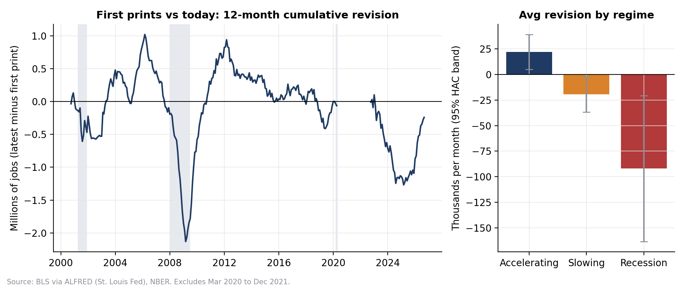
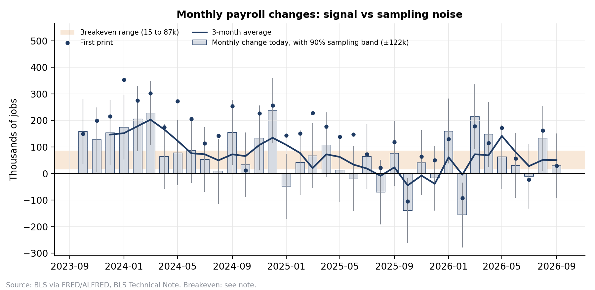

# Is the payroll print overstating US labour demand?

Code and data behind my research note ([`note/US_Payrolls_Note.pdf`](note/US_Payrolls_Note.pdf)) on the gap between the US establishment (payroll) survey and the household survey, how payroll revisions behave at turning points, whether that bias can be used in real time, and what it means for reading monthly prints.

## Question

Monthly nonfarm payrolls move front-end rates, the dollar and equity index futures more than almost any other release. But the first print is a sample estimate, it is revised twice in the following months and again at the annual benchmark, and it often disagrees with the household survey. This project asks:

1. How large and how biased are payroll revisions, and does the bias change when the labour market is slowing?
2. How far apart are the two surveys once they are measured on the same concept?
3. How much of a monthly print is signal, relative to sampling error and the current breakeven pace?
4. Does the 2-year yield react to revisions of earlier months as well as to the headline?
5. As an example of transmission, how much do payroll-day moves in US rates pass into Asian FX (the managed yuan against the floating Korean won)?
6. Does the revision bias survive when regimes are defined only with data available on the day, and do release-day moves in the 2-year reverse?
7. Is the labour market adding to inflation through wages?

## Conclusion

US payroll growth has slowed to about 50k to 65k a month, inside the 15k to 87k breakeven range implied by lower immigration, while unemployment has fallen from a 4.5% peak to 4.2%. The slowdown looks like weaker labour supply, not collapsing demand. With hindsight regimes, first prints since 2000 have been revised down by about 19k a month when job growth is slowing (t = -2.1) and by 92k in recessions, almost entirely through the annual benchmark rather than late survey responses. Defined only with data available on the day, the slowing-regime bias shrinks to 16k a month and is not significant (t = -1.4), and release-day moves in the 2-year do not reverse over the next 10 trading days. The bias is a reason to discount strong first prints, not a trade on its own. 16 of the last 24 prints are statistically indistinguishable from zero, so the 3-month average, unemployment and continuing claims carry more information than any single headline. The 2-year yield already prices revisions to prior months (2.8bp per 100k, at least as much as the headline relative to trend), but on release day it does not react to the unemployment rate. As an example of transmission, since the 2015 reform the onshore yuan has moved a statistically significant 0.21% per 10bp of US 2-year yield change on payroll days, comparable to the won, whose estimate is too noisy to be significant.

## Key charts





## Data

| Source | Series | Use |
| --- | --- | --- |
| BLS via ALFRED (St. Louis Fed) | PAYEMS, every vintage since 1990 | First, second, third print vs latest |
| BLS via FRED | PAYEMS, USPRIV, CE16OV, UNRATE, CLF16OV, CIVPART, CNP16OV, JTSJOL | Levels, divergence, breakeven |
| Dept. of Labor via FRED | ICSA, CCSA | Claims cross-check |
| ADP Research via FRED | ADPMNUSNERSA | Private payroll cross-check |
| Federal Reserve H.15 via FRED | DGS2 | Market reaction |
| Federal Reserve H.10 via FRED | DEXCHUS, DEXKOUS | Asian FX example |
| BLS via FRED | CES0500000003, ECIWAG, CPILFESL | Wage growth and core CPI |
| BEA via FRED | PCEPILFE | Core PCE inflation |
| NBER via FRED | USREC | Recession regime |
| BLS public API | LNS16000000, household employment adjusted to the payroll concept | Like-for-like comparison |

## Method

- **Revisions (`src/02_revisions.py`):** For each reference month since 2000, the monthly change as published in its first, second and third release, and today. Revisions are split into sample revisions (third minus first) and benchmark plus seasonal revisions (latest minus third). Means are tested with Newey-West standard errors, by regime (accelerating, slowing, recession). March 2020 to December 2021 are excluded from statistics.
- **Divergence (`src/03_divergence.py`):** Payrolls vs household employment on the payroll concept. Level change since December 2019 is shown with January population-control breaks marked. The clean comparison is monthly changes excluding Januaries (last 12 months and 6-month average).
- **Noise and breakeven (`src/04_noise_breakeven.py`):** Last 36 monthly prints (first and latest) against the BLS 90% sampling interval (±122k) and the published breakeven range of 15k to 87k (Bick, St. Louis Fed, March 2026). The code also contains a simple population and participation breakeven, which is switched off in `config.py`.
- **Cross-checks (`src/05_crosschecks.py`):** Claims, JOLTS openings, ADP and the unemployment rate against their 2018 to 2019 averages.
- **Market reaction (`src/06_market_reaction.py`):** Release-day change in the 2-year yield regressed on the headline relative to its prior 3-month trend (a surprise proxy, as consensus data needs Bloomberg) and on revisions to the two prior months. A second regression adds the change in the unemployment rate.
- **Asian FX example (`src/07_asian_fx.py`):** USD/CNY and USD/KRW moves over a two-day window around each release (the noon New York won rate mostly reflects the Seoul session), regressed on the release-day change in the 2-year yield, before and after the August 2015 fixing reform.
- **Real-time test (`src/08_realtime_test.py`):** Each month's regime is defined from the vintage published on its release day. Revision bias is re-tested by real-time regime, and the 2-year yield change over the 10 trading days after each release is compared with the release-day move and with the average drift after all releases.
- **Wages and inflation (`src/09_wages_inflation.py`):** Average hourly earnings and the Employment Cost Index (year on year and annualised short-run rates) against the 3.0% to 3.5% wage growth consistent with 2% inflation, plus core PCE and core CPI, each compared with its 2018-19 average.

## How to run

```bash
pip install -r requirements.txt
echo "YOUR_FRED_KEY" > fred_key.txt     # free key from fredaccount.stlouisfed.org
python run_all.py                        # downloads data and runs every step
python run_all.py --skip-download        # re-run analysis only
```

The household series on the payroll concept is pulled from the BLS public API into `data/manual/` (no key needed). Settings such as the sampling interval and breakeven range are in `config.py`.

Outputs: charts in `outputs/charts/`, tables in `outputs/tables/`, and a plain-text summary in `outputs/key_numbers.txt`.

## Limitations

- The surprise measure is a proxy, not consensus. Results on market reaction are indicative.
- The sampling interval on a 3-month average assumes independent monthly errors, which overstates precision.
- The main revision table defines regimes with today's data. `src/08_realtime_test.py` repeats the test in real time, where the bias is weaker and not significant.
- October 2025 household data is missing (government shutdown) and is interpolated. January household changes are excluded from flow comparisons because of population-control resets.
- DEXCHUS is the onshore yuan rate, not offshore CNH. The won estimate is noisy.